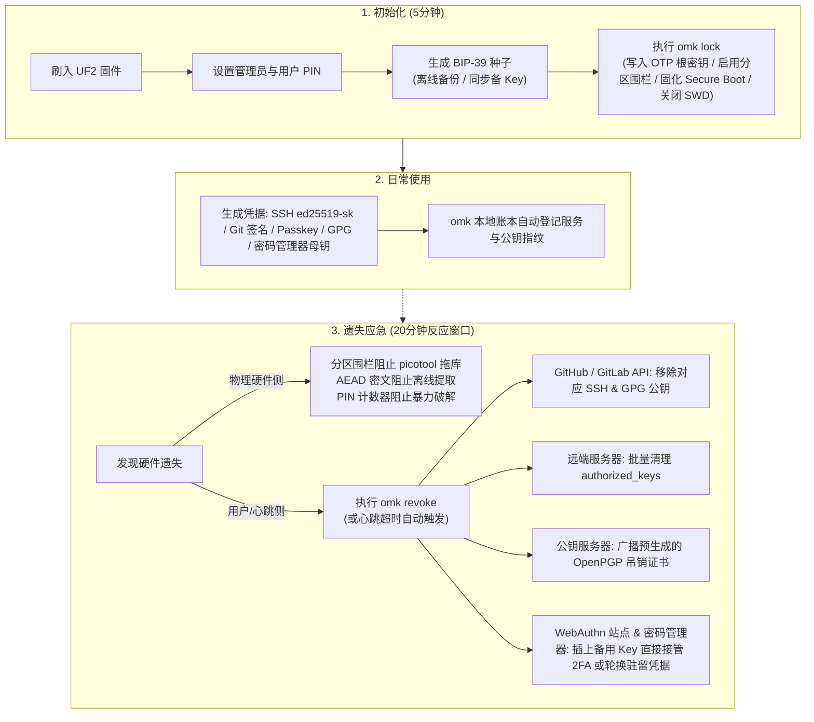

# OhMyKei 架构设计与技术路线图

> **目标硬件**：RP2350-Zero-CM (RP2350A, 2MB NOR Flash, Type-C 公口)  
> **核心协议**：FIDO2 / WebAuthn（纯 CTAP 2.1）+ OpenPGP Card 3.4（纯 ECC）  
> **技术栈与许可**：C17，MIT 许可证  

---

## 1. 产品定位与核心场景

### 1.1 项目定位
OhMyKei 是专为程序员打造的开源硬件安全密钥，旨在用单把 Key 覆盖现代开发与日常运维的核心身份场景：
- **WebAuthn / Passkey**：浏览器无密与双因子登录（GitHub、GitLab、云厂商控制台等）。
- **密码管理器硬件母钥（分层信任）**：作为底层物理信任根，通过标准 WebAuthn 2FA、WebAuthn PRF（CTAP2 `hmac-secret` 免主密码金库解密）及 OpenPGP 保护 1Password、Bitwarden 与 `pass` (password-store)，由上层密码管理器接管日常网站密码与软件 TOTP。
- **SSH 认证与 Git 签名**：基于 `ed25519-sk` 的 SSH 密钥登录与 Git 提交签名。
- **OpenPGP**：基于 OpenPGP Card 3.4 纯 ECC 的文件加解密、软件包/邮件签名与认证。
- **硬件对称密钥派生**：基于 CTAP2 `hmac-secret` 的全盘加密解锁（`systemd-cryptenroll`）与文件加解密（`age-plugin-fido2-hmac`）。

### 1.2 威胁模型与三条工程底线
- **威胁模型**：通用微控制器（RP2350）缺乏专用安全芯片（SE, 如 CC EAL6+）的硬件物理防护能力，无法防御开盖、FIB、激光毛刺等耗时/实验室级物理攻击。因此，项目**不进行无收益的硬件物理军备竞赛**，坚决不设厂商专有信任根，不依赖任何云端或 Web 控制台。
- **三条工程底线**：
  1. **MIT 洁净室规范实现**：纯粹依据开放规范（CTAP 2.1, OpenPGP Card 3.4, CCID 1.1, ISO 7816-4）从零编写；对现存开源实现（canokey、RS-Key）仅做架构行为与踩坑参考，严禁复制源码或逐行直译（翻译仍属衍生作品），并在 `docs/CLEAN_ROOM.md` 中记录规范对照。
  2. **严格的宽松开源许可白名单**：仅接受宽松开源协议（MIT / BSD / ISC / CC0），坚决不引入 Apache-2.0 及 Copyleft 依赖，避免对二次开发与商业分发施加传染性限制。当前依赖严格收敛为：`pico-sdk` (BSD-3)、`TinyUSB` (MIT)、`LittleFS` (BSD-3)、`BearSSL` (MIT)、`Monocypher` (BSD-2 / CC0)。
  3. **程序员自主可控与防单点故障**：固件无厂商私有后门与隐藏证书。硬件设备仅作为防远程劫持与防误触的物理隔离容器；通过 BIP-39 助记词实现主备双 Key 快速同步，并在设备遗失后通过一键脚本迅速完成服务端授权撤销。

---

## 2. 安全防线与设计取舍

### 2.1 三层纵深防御体系
放弃不切实际的防开盖幻想，安全重心精准聚焦于三个防御阶段：

| 防御层级 | 核心目标 | 关键技术实现 |
| :--- | :--- | :--- |
| **第一层：USB 边界零妥协**<br>(设备插在主机上时) | 杜绝恶意软件或恶意网页通过 USB 接口实施静默攻击或越权读取 | - 所有协议解析器（CTAPHID/CBOR/CCID/APDU/TLV）在 Host 端脱离硬件编译，接入 **libFuzzer + ASan/UBSan** 持续模糊测试。<br>- 所有签名、注册、解密操作强制按下板载 BOOTSEL 键完成物理在场确认（UP）。<br>- Flash 维护 PIN 重试计数器（FIDO 8 次，OpenPGP 3 次），PIN 仅保存哈希或 KDF 参数（支持 KDF-DO）。<br>- 软件密码学采用 BearSSL 常数时间实现，硬件 TRNG 播种，敏感内存即用即清，配备看门狗。 |
| **第二层：20 分钟物理防线**<br>(设备在物理世界遗失时) | 阻断攻击者通过 USB 命令或简单飞线导出私钥，为用户争取处置时间 | - **存储静态加密**：LittleFS 敏感记录全量通过 AEAD（AES-GCM / ChaCha20-Poly1305）加密，主密钥由用户 PIN（KDF）与片上随机根密钥（MKEK）联合派生。<br>- **分区表围栏**：数据分区配置 `bootloader: ""`，阻止按住 BOOTSEL 插电后通过 `picotool save --all` 直接拖取数据镜像。<br>- **固件锁板（`omk lock`）**：生产板写入随机 OTP 存储根密钥并锁定该页；通过 `picotool seal` 烧录固件 hash 开启 Secure Boot；关闭 SWD 调试口（开发板保持解锁状态便于调试）。 |
| **第三层：遗失即主动熔断**<br>(确认设备物理丢失后) | 在服务端彻底吊销公钥与授权，终结硬件泄露风险 | - **一键熔断脚本（`omk revoke`）**：依据本地注册账本，一键批量调用 GitHub/GitLab API 移除 SSH/GPG 公钥、清理受管服务器 `authorized_keys`、广播 OpenPGP 吊销证书、并列出 WebAuthn 站点清单引导轮换。<br>- **心跳 / 死人开关（Heartbeat）**：支持可选的定时在位检测与远端续期机制，超时未签到自动告警或触发熔断脚本。 |

### 2.2 范围瘦身与明确不做的项
为了聚焦核心开发场景并保障固件小巧可审计，项目明确排除了以下非目标（**Agent 编码时严禁引入相关代码或状态机**）：
- **协议与接口裁剪**：
  - **砍掉 U2F / CTAP1 兼容层**：不实现 `CTAPHID_MSG`（APDU 封装）及预置 X.509 批次证书；现代浏览器、1Password/Bitwarden、GitHub 与 `libfido2` 均已全面转向纯 CTAP 2.1。
  - **砍掉 OATH (YKOATH TOTP/HOTP)**：日常 6~8 位动态口令统一交由受 OhMyKei 保护的上层密码管理器（1Password / Bitwarden / `pass-otp`）托管，省去片上 OATH 凭据槽与宿主机 `omk oath` CLI 维护成本。
  - **砍掉 CTAP 2.1 `largeBlobs` (`0x0C`) 与 `largeBlobKey`**：SSH 驻留密钥走标准 `credentialManagement`，对称密钥派生走 `hmac-secret`；`largeBlobs` 的分片重组与整包 SHA-256 校验与“全栈零 `malloc`”及“单步 `< 50ms`”硬约束冲突，且协议自身缺乏单凭据删除时的垃圾回收机制，极易造成 Flash 孤儿密文泄漏与跨命令状态机 Fuzz 负担。
  - **砍掉 PIV / X.509 证书槽**：个人开发者场景已由 SSH/GPG 覆盖，避免承担复杂的 BER-TLV 证书槽状态机。
  - **砍掉 RSA (2048~4096)**：全场景拥抱 ECC；去除大数运算库及数十秒的片上密钥生成开销。
  - **砍掉键盘 HID 与 Yubico OTP**：避免按键误触在活动窗口中乱吐字符，去除维护 USB HID 键盘栈与 Feature Report 的复杂度。
  - **砍掉 HMAC-SHA1 challenge-response**：不兼容 KeePassXC 原生硬件解锁（KeePassXC 尚未支持 CTAP2 `hmac-secret`，见 issue #3560）；对称密钥派生统一走标准的 CTAP2 `hmac-secret`。
  - **砍掉超范围算法**：固件仅实现 Ed25519、X25519 与 P-256。不实现 P-384、P-521、固件侧 secp256k1（主机侧仅由 `picotool` 用于 Secure Boot 签名）、国密（SM2/3/4）及 PQC。
  - **砍掉设备端动态 X.509/自建 CA**：FIDO2 严格采用 `Self Attestation` 或 `None`。
  - **不做 Yubico VID/PID 伪装与 NFC/Web 控制台**：向 pid.codes 申请合法 PID，仅在协议层兼容；板载无 NFC，管理交互统一走 CLI。
- **硬件攻防裁剪**：
  - **砍掉片内 OTP 熔丝单调计数器**：防御热风枪拆焊 Flash 重放快照的成本与收益不成正比，PIN 计数器直接存 Flash。
  - **砍掉 OTP PVC Chaff 与多阶段固化仪式**：不设实验室级防电子显微镜冗余，OTP 烧录收敛为一条 `omk lock` 命令。
  - **砍掉微架构周期实测与 DPA 掩码**：直接采用 BearSSL 常数时间算法，不折腾 DWT 周期测量等脆弱的微架构技巧。
  - **不做 TrustZone 隔离与 A/B 固件槽**：单一裸片隔离收益微弱；RP2350 BootROM BOOTSEL 具备物理防砖能力，空间让渡给数据存储。

### 2.3 密码管理器协同与分层信任规范 (M3/M5 实现契约)
为确保 FIDO2 + OpenPGP 与主流密码管理器（1Password、Bitwarden、`pass`）无缝协同，固件实现须遵守以下契约：
- **Attestation 降级兼容**：FIDO2 仅实现 `Self Attestation` 与 `None`。当依赖方（如 1Password / Bitwarden）在 `makeCredential` 中请求 `attestation: "direct"` 时，固件必须按 CTAP 2.1 规范正常返回 `Self` 签名格式，严禁返回错误码拒绝注册。
- **WebAuthn PRF (`hmac-secret`) 免密金库解锁**：支持驻留凭据（RK）+ `clientPIN` (UV) + `hmac-secret` 组合调用，使 Bitwarden 等支持 WebAuthn PRF 扩展的客户端可通过 OhMyKei 直接派生对称密钥并解密本地金库。
- **主备 Key 签名计数器（`signCount`）防回退策略**：当通过 BIP-39 助记词将非驻留凭据同步至主备双 Key 交替使用时，为防止两把 Key 独立 Flash 计数器进度不一触发服务端克隆回退告警，非驻留凭据模式支持将 `signCount` 恒置为 `0`（符合 CTAP 2.1 规范）或按单调大步进对齐。

---

## 3. 功能规划与凭据架构

### 3.1 版本规划

#### P0：最小可行产品（MVP —— 纯 CTAP 2.1 闭环）
- **传输层**：纯 CTAPHID 接口。
- **FIDO2 核心与安全策略**：CTAP 2.1 核心命令（`getInfo`、`makeCredential`、`getAssertion`、`getNextAssertion`、`clientPIN` v1/v2 + token permissions、`reset`、`selection`、`credentialManagement`、`minPinLength`、`alwaysUv`）。
- **算法与特性**：ES256 (P-256) 与 EdDSA (Ed25519)；驻留凭据（≥256 条，由存储限制决定）；`credProtect`；`hmac-secret`（兼容 Bitwarden PRF、`systemd-cryptenroll`、`age-plugin-fido2-hmac`、`libfido2`）。
- **交互与指示**：BOOTSEL 按键物理在场确认（UP），WS2812 状态指示灯（空闲/等待触摸/处理中/错误）。
- **运维工具**：`omk` 基础 CLI、BIP-39 助记词备份恢复、一键熔断脚本框架（SSH/GitHub/GitLab）、心跳守护程序示例。

#### P1：完整生产形态（引入 CCID 与 OpenPGP）
- **传输层**：TinyUSB 复合设备引入 CCID 1.1 接口。
- **OpenPGP Card 3.4（纯 ECC 子集）**：Ed25519（签名/认证）、X25519（解密，原生兼容 `gpg-agent` 与 `pass`）、P-256 兼容、UIF 按键确认、KDF-DO；自动生成吊销证书并接入 `omk revoke`。

### 3.2 非驻留凭据派生模型
为实现无状态大容量存储及主备 Key 无缝切换，非驻留凭据采用自包含加密派生结构：
```text
credential ID = ver || nonce || MAC(K_mac, rpIdHash || nonce || alg || flags)
private key   = HKDF(seed, nonce || rpIdHash)
```
- **字段说明**：`ver` 为格式版本号；`nonce` 为随机构建的凭据盐值；`MAC` 将依赖方哈希、算法与配置参数紧密绑定；`HKDF` 依据根种子与上下文安全派生用户私钥。
- **容灾优势**：所有非驻留凭据（含 1Password / Bitwarden / GitHub 等绑定的 WebAuthn 2FA）均由主种子动态派生，本地无需落盘保存。备份 BIP-39 助记词即完整备份了全部非驻留凭据，主 Key 遗失后备用 Key 可直接无缝接管。

---

## 4. 架构设计与技术选型

### 4.1 目录组织
```text
CMakeLists.txt            # 顶层 CMake：固件与 Host 测试统筹
CMakePresets.json         # 构建预设：fw-release / fw-debug / host / fuzz
cmake/pico_sdk.cmake      # pico-sdk 定位与官方 import 桥接
src/
  platform/               # 硬件抽象层：BOOTSEL 采样、TRNG、Flash 读写、USB 描述符
  transport/              # 协议传输：ctaphid.c、ccid.c（TinyUSB 回调仅做数据搬运）
  core/                   # 核心基础：cbor.c、tlv.c、apdu.c、storage.c、crypto_hal.h
  apps/                   # 应用实现：fido2/、openpgp/、mgmt/
host/                     # Host 端单元测试与集成测试入口（Linux/macOS）
tools/omk/                # Python CLI 工具包：管理、备份、账本、revoke、lock
```

> **注意**：遵循 2.2 节裁剪规范，`src/apps/` 下严格只保留 `fido2/`、`openpgp/` 与 `mgmt/`。

### 4.2 三大架构硬约束

#### 约束 A：绝对非阻塞 Job 调度模型
任何协议处理函数严禁包含阻塞等待（如按键轮询或硬 sleep）：
- **主循环极简分发**：
  ```c
  while (true) {
      tud_task();            // 1. USB 事件轮询
      transport_tick(now);   // 2. 传输层心跳与保活推进
      job_step(now);         // 3. 当前任务单步推进
  }
  ```
- **时间片状态机**：所有耗时操作抽象为 `job_t`，通过 `step(job, now_ms)` 每次仅执行有界时间片操作。UP 采样通过按键轮询状态机实现，超时自动退出。
- **自动保活机制**：当有 Job 处于挂起（`JOB_PENDING`）状态时，传输层自动接管心跳维护（CTAPHID 约每 100ms 自动回复 `KEEPALIVE`，CCID 自动发送 `Time Extension`），业务层无感。
- **排他与并发**：同一时刻仅允许单 Job 运行，并发请求直接响应协议层 `BUSY`。
- **Flash 擦除切分**：Flash 擦除必须按 4 KB 扇区粒度分割，严禁在 UP 等待或高频中断期间触发全局擦除。

#### 约束 B：USB 边界零信任与 Fuzz 驱动开发
外部字节流被视为敌手可控数据，必须经过严密校验方可进入状态机：
- **游标式安全解析**：`cbor.c`、`tlv.c`、`apdu.c`、`ctaphid.c`、`ccid.c` 一律采用带边界界定的 cursor/slice 助手函数，禁止直接裸指针偏移运算。
- **全面覆盖的 LibFuzzer 目标**：在 `host/fuzz/` 构建 CTAPHID 分包重组、CBOR 解码、CCID 帧解析、APDU 路由等 Fuzz Target，强挂 ASan + UBSan 纳入 CI 自动阻断。
- **防越权负向测试**：针对“未验证 PIN 执行签名”、“未完成 UP 窃取结果”、“跨应用状态污染”等典型攻击路径编写强校验测试用例。

#### 约束 C：轻量常数时间密码学栈
- **依赖选型**：
  - **BearSSL（MIT）**：提供常数时间 P-256（`br_ec_p256_m31`）、AES（`br_aes_ct_*`）、SHA-256/512、HMAC、HKDF。排斥查表实现的 `aes_small` / `aes_big`。
  - **Monocypher（BSD-2 / CC0）**：提供 RFC 8032 Ed25519、X25519、ChaCha20-Poly1305。
- **`crypto_hal.h` 抽象屏障**：上层业务代码禁止直接引用 BearSSL/Monocypher 头文件（CI 脚本静态扫描检查）。密码学接口仅接受外部传入的定长缓冲区与上下文，**全栈零 malloc 动态分配**；中间敏感变量退出前即刻清零。
- **随机源与测试验证**：固件端通过 RP2350 硬件 TRNG 播种 HMAC_DRBG；Host 端借助 Wycheproof 全量测试向量集持续回归校验。

### 4.3 硬件适配与资源预算
- **板级支持**：直接复用 `pico-sdk` 官方 `boards/waveshare_rp2350_zero.h` 与 `pico_status_led`（基于 PIO 自动驱动 WS2812B GRB，内置 50µs 锁存）。Flash 空间通过 `pico_override_flash_size(ohmykei 2097152)` 定制为 2 MB。
- **单核执行预算（Core 0）**：去除片上 RSA 计算与 `largeBlobs` 整包重组后，单个 Job step 最坏连续耗时（密码学计算 + 单块 Flash 擦写）预算严格控制在 **< 50 ms**，完全在 USB 保活周期安全阈值内，保持纯单核运行即可，避免双核死锁与同步复杂度（M1 片上实测验证，M3 回归）。
- **Flash 存储布局（2 MB 总量）**：
  - `0x0000_0000 - 0x0000_2000` (8 KB)：分区表 Boot Slots（picotool 保留）
  - `0x0000_2000 - 0x0010_2000` (1024 KB)：固件镜像区
  - `0x0010_2000 - 0x001E_0000` (888 KB)：LittleFS 加密数据区（AEAD 凭据记录）
  - `0x001E_0000 - 0x0020_0000` (128 KB)：环形磨损均衡区（高频写入的 FIDO 签名计数器）

---

## 5. 程序员运维工作流



> **说明**：开发板调试阶段保持未锁状态；**任何投入实际使用的生产 Key 必须执行 `omk lock`**。

---

## 6. 里程碑规划与交付清单

### M0：基础设施搭建
- [ ] 许可与合规文档：`LICENSE` (MIT)、`THIRD_PARTY_NOTICES`、`docs/CLEAN_ROOM.md`。
- [x] CMake 骨架构建：
  - 支持 `fw-release` / `fw-debug` / `host` / `fuzz` 预设；
  - 适配 RP2350-Zero-CM 2MB 覆盖与板载 WS2812B 点灯。
- [ ] 非阻塞 Job 基础调度库：定义 `job_t`、单任务时间片调度、假时钟单测（超时/取消/BUSY）。
- [ ] Fuzzing 与测试管线：基于 libFuzzer + ASan/UBSan 的 Host 编译脚本与回归验证。
- [ ] 申请 pid.codes 合法开源 VID/PID（`1209:xxxx`）。

### M1：硬件平台层与安全存储
- [ ] 平台驱动封装：TRNG 随机数生成与自检、BOOTSEL 按键 UP 采样 Job。
- [ ] 基于 `pico_status_led` 的 LED 状态机（空闲/等待触摸/处理中/错误）。
- [ ] 存储系统构建：LittleFS 移植 + AEAD 记录加密层（PIN KDF + 随机根密钥）+ 掉电一致性测试。
- [ ] 基础密码学接入：P-256、Ed25519、X25519 基础原语与 Wycheproof 测试向量验证。
- [ ] Flash 擦除延迟实测，确认单核 < 50ms 预算达标。
- [ ] 分区表生成脚本（配置数据区 `bootloader: ""` 阻止 USB 导出）。

### M2：USB 协议传输层 (CTAPHID)
- [ ] TinyUSB 复合描述符配置（优先启用 CTAPHID）。
- [ ] CTAPHID 协议完整实现（不含 `CTAPHID_MSG` U2F 路由）：
  - INIT / CBOR / PING / CANCEL / KEEPALIVE / WINK / LOCK 命令集；
  - 通道分配、分包重组、超时机制与 libFuzzer target。
- [ ] Job 挂起状态下传输层自动发送 KEEPALIVE，CANCEL 正确联动 `job.cancel()`。

### M3：FIDO2 (CTAP 2.1) 核心与安全策略 (P0 里程碑)
- [ ] CBOR 规范解析器实现与 Fuzz 校验。
- [ ] CTAP 2.1 核心命令处理：`getInfo`、`makeCredential`、`getAssertion`、`getNextAssertion`、`selection`、`reset`。
- [ ] `clientPIN` v1/v2、Token 权限管理、PIN 失败递减与锁死机制。
- [ ] 进阶安全策略：`minPinLength` 与 `alwaysUv` 强制策略支持。
- [ ] 算法支持：ES256 (P-256) 与 EdDSA (Ed25519)。
- [ ] 非驻留凭据派生（含主备双 Key `signCount` 防回退处理）与驻留凭据存储（支持 `credentialManagement`）。
- [ ] `credProtect` 与 `hmac-secret`（WebAuthn PRF）扩展。
- [ ] 全生态互操作测试：`python-fido2`、`libfido2`、`webauthn.io`、1Password / Bitwarden (2FA & PRF)、SSH `ed25519-sk`、Git 签名、`systemd-cryptenroll`、`age-plugin-fido2-hmac`。

### M4：omk 运维工具链与一键熔断 (P0 里程碑)
- [ ] `omk` CLI 基础框架与设备状态交互。
- [ ] 密钥账本管理与一键熔断工具（`omk revoke`）：
  - GitHub / GitLab API 自动吊销插件；
  - 服务器 `authorized_keys` 批量清除脚本；
  - WebAuthn 绑定清单与轮换引导。
- [ ] 心跳 / 死人开关参考实现（`examples/heartbeat/`）。
- [ ] BIP-39 助记词备份恢复模块（主备 Key 快速同步）。
- [ ] 一键锁板命令 `omk lock`：写入并固化 OTP 根密钥、烧录 `picotool seal` 固件 hash、开启 Secure Boot、禁用 SWD。

### M5：CCID 传输层与 OpenPGP Card 纯 ECC (P1 里程碑)
- [ ] TinyUSB CCID Class Driver 扩展与 ISO 7816-4 APDU 分发路由。
- [ ] CCID 挂起期间自动发送 Time Extension 保活机制。
- [ ] CCID / APDU / TLV libFuzzer 覆盖。
- [ ] OpenPGP Card 3.4 纯 ECC 功能实现：Ed25519（签名/认证）、X25519（解密）、P-256 兼容、UIF 触摸确认、KDF-DO。
- [ ] GnuPG 生态兼容性测试（`gpg --card-status`、文件加解密、`pass` 密码库解锁、SSH-agent 转发）。
- [ ] GPG 吊销证书预生成机制并联动 `omk revoke`。

### M6：发布工程与合规交付
- [ ] 基于 Docker / Nix 的可复现编译流水线。
- [ ] 官方 Release 固件签名与分发。
- [ ] 软件物料清单（SBOM）与运行时栈/内存水位审计报告。

---

## 7. 附录：核心架构决策索引

| 决策项 | 选定方案 | 核心理由与设计权衡 |
| :--- | :--- | :--- |
| **协议栈范围** | 纯 CTAP 2.1 + OpenPGP 3.4 | 砍掉 U2F、OATH 与 `largeBlobs`；以最小状态机面积覆盖 99% 现代开发、签名与硬件加密场景。 |
| **密码管理器协同** | 分层信任（FIDO2 2FA/PRF + OpenPGP） | OhMyKei 作为硬件母钥锁住 1Password / Bitwarden / `pass`，由密码管理器托管日常密码与 TOTP；利用 BIP-39 非驻留派生实现主备 Key 无感接管。 |
| **密码学依赖** | BearSSL + Monocypher | 零动态堆内存分配，全常数时间算法，MIT/BSD 宽松协议；上层经 `crypto_hal.h` 强隔离。 |
| **算法范围** | 仅保留 Ed25519 + X25519 + P-256 | 充分覆盖开发者日常场景；坚决剔除 RSA（消除片上数十秒大数生成延迟）与国密/PQC（体积敏感）。 |
| **物理防御策略** | 20 分钟 Easy Hack 防线 + 遗失即熔断 | 承认通用 MCU 物理局限，放弃高成本低边际收益的防拆防开盖设计，重心转向服务端主动吊销。 |
| **并发与调度** | 纯单核极简分片调度（Job 模型） | 单次不可抢占操作 < 50ms，避免双核死锁风险；传输层自动发送心跳对上层业务完全透明。 |
| **USB 防御** | 100% Host 编译 + LibFuzzer 门禁 | 守住 USB 第一边界，杜绝缓冲区越界与状态机混淆攻击。 |
| **设备生态** | 自主申请 PID，放弃冒用 Yubico | 仅做标准协议层兼容，避免生态侵权风险；配套自有 `omk` CLI 工具链进行运维管理。 |

---

## 8. 附录：术语表与规范索引

### 8.1 术语表
- **RP (Relying Party)**：依赖方，即请求认证的 Web 服务或应用程序。
- **UP (User Presence)**：用户在场确认，本项目通过物理按下板载 BOOTSEL 按键触发。
- **UV (User Verification)**：用户身份验证，如验证本地 PIN 码。
- **PRF (Pseudo-Random Function)**：WebAuthn 对称密钥派生扩展，底层映射为 CTAP 2.1 `hmac-secret`，用于 Bitwarden 等密码管理器免密金库解锁。
- **CTAP2 / CTAPHID**：FIDO2 客户端与安全密钥间的应用协议及其 USB HID 传输承载层。
- **CCID**：USB 智能卡接口标准，OpenPGP 基于此接口通信。
- **MKEK (Master Key Encryption Key)**：片上随机生成的设备根密钥，用于与 PIN 共同派生存储主密钥。
- **Resident / Non-resident Credential**：驻留凭据（元数据与私钥持久化于板内存储）与非驻留凭据（凭据自包含，由根种子动态派生，板内不落盘）。

### 8.2 参考规范
- **RP2350 Datasheet**: [datasheets.raspberrypi.com](https://datasheets.raspberrypi.com/rp2350/rp2350-datasheet.pdf)
- **FIDO CTAP 2.1**: [fidoalliance.org](https://fidoalliance.org/specs/fido-v2.1-ps-20210615/fido-client-to-authenticator-protocol-v2.1-ps-20210615.html)
- **OpenPGP Smart Card 3.4**: [gnupg.org](https://gnupg.org/ftp/specs/OpenPGP-smart-card-application-3.4.pdf)
- **USB CCID 1.1**: [usb.org](https://www.usb.org/sites/default/files/DWG_Smart-Card_CCID_Rev110.pdf)
- **ISO/IEC 7816-4**: [iso.org](https://www.iso.org/standard/77185.html)
- **KeePassXC Issue #3560**: [github.com](https://github.com/keepassxreboot/keepassxc/issues/3560)
